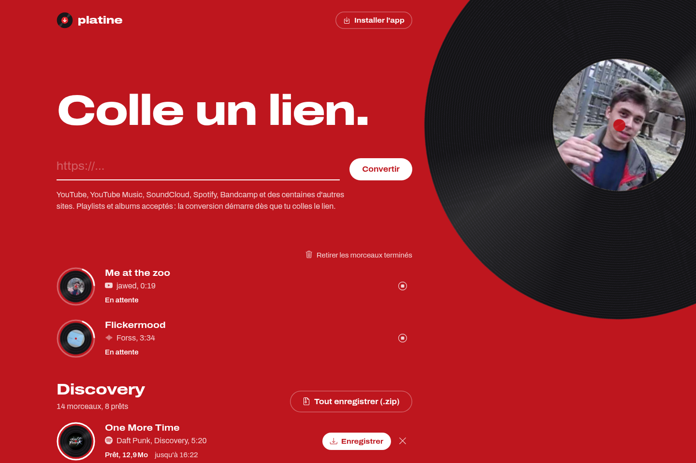

<p align="center">
  
</p>

<p align="center"><b>Paste a link, get the MP3.</b><br>
YouTube, YouTube Music, SoundCloud, Spotify, Bandcamp and hundreds of other sites,
as 320 kbps MP3 files with title, artist, album and cover.</p>

<p align="center">
  <a href="https://github.com/BaptGosse/Platine/actions/workflows/ci.yml"></a>
  <a href="https://baptgosse.github.io/Platine/python/html/"></a>
  <a href="https://baptgosse.github.io/Platine/js/html/"></a>
  
  <a href="LICENSE"></a>
</p>

<p align="center">
  
</p>

## Features

- **One link is enough**: paste it and the conversion starts. Several links at once, drag and drop, a bookmarklet
  and Android sharing (once the app is installed) work too.
- **Playlists and albums** are split into tracks, converted in parallel and downloadable as one zip.
- **Spotify**: its audio is DRM-protected and cannot be downloaded. Platine reads the track details on Spotify,
  finds the same recording on YouTube Music (title, artists, duration and album are compared), then writes the
  Spotify tags and cover into the MP3.
- **Live progress**: every track is a record that spins while it converts, with its progress drawn around it.
  Cancel, retry and remove work track by track, and the list survives a reload.
- **French and English** interface, switchable at any time.
- **Installable app (PWA)**: home screen icon, interface available offline, update offered when a new version is deployed.
- **Command line**: `platine download LINK...` with progress bars.
- **Production ready**: non-root read-only container, Helm chart, Prometheus metrics, optional password,
  cookies and proxy for picky sites.

## Legal notice

> [!WARNING]
> Platine is a tool. You are solely responsible for how you use it, and the authors are not responsible for any
> illegal use. Only download content you have the rights to: your own works, content whose license allows it,
> or, where the law of your country provides a private copy exception, a personal copy of content you lawfully
> own (for example music you bought). Downloading copyrighted content without permission is illegal in most
> countries, and many sites, YouTube and Spotify included, forbid downloads in their terms of service.

## Tech stack

Everything Platine is built on is open source. Each badge links to the project and each license to its text.

### Download and conversion

| Tool | Used for | License |
| --- | --- | --- |
| [](https://www.python.org) | language of the server and the command line, 3.12+ | [PSF-2.0](https://github.com/python/cpython/blob/main/LICENSE) |
| [](https://github.com/yt-dlp/yt-dlp) | reads links and downloads the best audio from 1,800+ sites | [Unlicense](https://github.com/yt-dlp/yt-dlp/blob/master/LICENSE) |
| [](https://ffmpeg.org) | encodes the 320 kbps MP3, embeds tags and cover | [LGPL-2.1+ / GPL-2.0+](https://github.com/FFmpeg/FFmpeg/blob/master/LICENSE.md) |
| [](https://deno.com) | JavaScript runtime yt-dlp needs for YouTube, and the frontend test runner | [MIT](https://github.com/denoland/deno/blob/main/LICENSE.md) |
| [](https://github.com/AliAkhtari78/SpotifyScraper) | Spotify track, album and playlist details without an API key | [MIT](https://github.com/AliAkhtari78/SpotifyScraper/blob/master/LICENSE) |
| [](https://github.com/sigma67/ytmusicapi) | finds the matching recording on YouTube Music | [MIT](https://github.com/sigma67/ytmusicapi/blob/main/LICENSE) |
| [](https://github.com/quodlibet/mutagen) | writes the Spotify ID3 tags and cover | [GPL-2.0-or-later](https://github.com/quodlibet/mutagen/blob/main/COPYING) |
| [](https://requests.readthedocs.io) | HTTP with retries for covers and YouTube Music | [Apache-2.0](https://github.com/psf/requests/blob/main/LICENSE) |

### Server and command line

| Tool | Used for | License |
| --- | --- | --- |
| [](https://fastapi.tiangolo.com) | HTTP API, static files and the generated service worker | [MIT](https://github.com/fastapi/fastapi/blob/master/LICENSE) |
| [](https://github.com/Kludex/uvicorn) | ASGI server | [BSD-3-Clause](https://github.com/Kludex/uvicorn/blob/main/LICENSE.md) |
| [](https://docs.pydantic.dev) | API models and validation | [MIT](https://github.com/pydantic/pydantic/blob/main/LICENSE) |
| [](https://github.com/pydantic/pydantic-settings) | `PLATINE_*` settings from the environment | [MIT](https://github.com/pydantic/pydantic-settings/blob/main/LICENSE) |
| [](https://github.com/trallnag/prometheus-fastapi-instrumentator) | `/metrics` endpoint with the HTTP metrics | [ISC](https://github.com/trallnag/prometheus-fastapi-instrumentator/blob/master/LICENSE) |
| [](https://github.com/prometheus/client_python) | conversion counters, durations and queue size | [Apache-2.0](https://github.com/prometheus/client_python/blob/master/LICENSE) |
| [](https://typer.tiangolo.com) | `platine download` and `platine serve` commands | [MIT](https://github.com/fastapi/typer/blob/master/LICENSE) |
| [](https://github.com/Textualize/rich) | progress bars in the terminal | [MIT](https://github.com/Textualize/rich/blob/main/LICENSE) |

### Interface

| Tool | Used for | License |
| --- | --- | --- |
| [](https://alpinejs.dev) | reactive interface without a build step | [MIT](https://github.com/alpinejs/alpine/blob/main/LICENSE.md) |
| [](https://alpinejs.dev/plugins/persist) | track list kept across reloads | [MIT](https://github.com/alpinejs/alpine/blob/main/LICENSE.md) |
| [](https://www.i18next.com) | French and English translations, plurals included | [MIT](https://github.com/i18next/i18next/blob/master/LICENSE) |
| [](https://github.com/i18next/i18next-browser-languageDetector) | picks the visitor's language and remembers the choice | [MIT](https://github.com/i18next/i18next-browser-languageDetector/blob/master/LICENSE) |
| [](https://developer.chrome.com/docs/workbox) | service worker: offline interface, updates, cover cache | [MIT](https://github.com/GoogleChrome/workbox/blob/v7/LICENSE) |
| [](https://icons.getbootstrap.com) | icons | [MIT](https://github.com/twbs/icons/blob/main/LICENSE) |
| [](https://github.com/Omnibus-Type/Archivo) | variable typeface with width and weight axes, files from Fontsource | [OFL-1.1](https://github.com/Omnibus-Type/Archivo/blob/master/OFL.txt) |

Every frontend library is vendored in `platine/static/vendor/` with its license: no CDN, no build step.

### Quality

| Tool | Used for | License |
| --- | --- | --- |
| [](https://docs.pytest.org) | Python unit tests | [MIT](https://github.com/pytest-dev/pytest/blob/main/LICENSE) |
| [](https://github.com/pytest-dev/pytest-cov) | coverage while testing, 100 % required | [MIT](https://github.com/pytest-dev/pytest-cov/blob/master/LICENSE) |
| [](https://coverage.readthedocs.io) | line and branch measurement, HTML and lcov reports | [Apache-2.0](https://github.com/coveragepy/coveragepy/blob/main/LICENSE.txt) |
| [](https://docs.astral.sh/ruff) | lint and formatting | [MIT](https://github.com/astral-sh/ruff/blob/main/LICENSE) |
| [](https://pylint.readthedocs.io) | deeper static analysis, rated 10/10 | [GPL-2.0-or-later](https://github.com/pylint-dev/pylint/blob/main/LICENSE) |
| [](https://github.com/SAP/pylint-per-file-ignores) | pytest-specific exceptions for the tests folder only | [MIT](https://github.com/SAP/pylint-per-file-ignores/blob/main/LICENSE) |
| [](https://mypy-lang.org) | static type checking | [MIT](https://github.com/python/mypy/blob/master/LICENSE) |
| [](https://github.com/getsentry/responses) | fake HTTP answers in tests | [Apache-2.0](https://github.com/getsentry/responses/blob/master/LICENSE) |
| [](https://github.com/pydantic/httpx2) | HTTP client behind the FastAPI test client | [BSD-3-Clause](https://github.com/pydantic/httpx2/blob/main/LICENSE.md) |
| [](https://github.com/smarie/python-genbadge) | coverage badges published to GitHub Pages | [BSD-3-Clause](https://github.com/smarie/python-genbadge/blob/main/LICENSE) |
| [](https://github.com/eriwen/lcov-to-cobertura-xml) | turns the JavaScript lcov report into the badge format | [Apache-2.0](https://github.com/eriwen/lcov-to-cobertura-xml/blob/master/LICENSE) |
| [](https://pre-commit.com) | the same checks before each commit | [MIT](https://github.com/pre-commit/pre-commit/blob/main/LICENSE) |

### Delivery

| Tool | Used for | License |
| --- | --- | --- |
| [](https://docs.astral.sh/uv) | dependencies, lock file and virtual environment | [MIT](https://github.com/astral-sh/uv/blob/main/LICENSE-MIT) / [Apache-2.0](https://github.com/astral-sh/uv/blob/main/LICENSE-APACHE) |
| [](https://hatch.pypa.io) | builds the Python package | [MIT](https://github.com/pypa/hatch/blob/master/LICENSE.txt) |
| [](https://podman.io) | container image, read-only and rootless | [Apache-2.0](https://github.com/podman-container-tools/podman/blob/main/LICENSE) |
| [](https://docs.docker.com/compose/) | the same compose file works with Docker | [Apache-2.0](https://github.com/docker/compose/blob/main/LICENSE) |
| [](https://helm.sh) | Kubernetes chart, published as an OCI artifact | [Apache-2.0](https://github.com/helm/helm/blob/main/LICENSE) |
| [](https://kubernetes.io) | Ingress or Gateway API, NetworkPolicy, ServiceMonitor | [Apache-2.0](https://github.com/kubernetes/kubernetes/blob/master/LICENSE) |
| [](https://github.com/yannh/kubeconform) | validates the rendered manifests in CI | [Apache-2.0](https://github.com/yannh/kubeconform/blob/master/LICENSE) |

CI runs on GitHub Actions, and Dependabot proposes dependency updates every week, yt-dlp first.

## Getting started

### With Podman or Docker

```bash
make up                 # podman compose up -d --build
```

Then open <http://localhost:8320>. `make down` stops it and `make logs` follows the logs.
With Docker: `make up CONTAINER=docker`, or directly `docker compose up -d --build`.

> Without the Makefile, Podman needs one setting when docker-compose is installed:
> `PODMAN_COMPOSE_PROVIDER=podman-compose podman compose up -d --build`
> (or enable the socket: `systemctl --user enable --now podman.socket`).

### Locally, for development

You need Python 3.12+, FFmpeg (`sudo dnf install ffmpeg`) and [uv](https://docs.astral.sh/uv/).
Without uv: `python3 -m venv .venv && .venv/bin/pip install uv`.

```bash
make install            # dependencies in .venv (uv sync)
make dev                # server with auto-reload on http://localhost:8320
```

### Command line

```bash
uv run platine download "https://www.youtube.com/watch?v=..." "https://open.spotify.com/album/..." -o ~/Music
uv run platine serve --host 0.0.0.0     # the web interface, without the Makefile
```

## Installing the app (PWA)

Browsers offer "Install the app" (button at the top right of the page) as soon as Platine is served over
**HTTPS** or on **localhost**: browsers only allow service workers there. Over plain HTTP on a local network,
the interface works but cannot be installed.

Once installed on Android, Platine appears in the **Share** menu of YouTube, SoundCloud, Spotify...:
sharing a track starts its conversion right away.

On a computer, the "Convert with Platine" bookmarklet at the bottom of the page can be dragged to the bookmarks bar:
one click from any music or video page sends it to Platine.

## Kubernetes

The chart lives in [`charts/platine`](charts/platine/README.md). To push the image and install it:

```bash
make push TAG=2.0.0             # ghcr.io/baptgosse/platine:2.0.0
make helm-install TAG=2.0.0
```

The chart offers an Ingress or an HTTPRoute (Gateway API), a NetworkPolicy that blocks internal addresses
(Platine downloads arbitrary links), a ServiceMonitor, and authentication and cookies from Secrets.
Conversions are kept in memory: stay at **one replica**.

## Settings

Every variable is optional.

| Variable | Default | Role |
| --- | --- | --- |
| `PLATINE_MAX_CONCURRENT` | `3` | Conversions running in parallel |
| `PLATINE_FILE_TTL` | `3600` | Seconds a finished MP3 stays downloadable |
| `PLATINE_MAX_PLAYLIST_ITEMS` | `100` | Maximum tracks kept per playlist or album |
| `PLATINE_MAX_QUEUED` | `500` | Waiting conversions beyond which Platine answers "try again later" |
| `PLATINE_AUTH_PASSWORD` | | Turns on a password (HTTP Basic) for everything except `/healthz` and `/metrics` |
| `PLATINE_AUTH_USERNAME` | `platine` | Matching user name |
| `PLATINE_COOKIES_FILE` | | `cookies.txt` file (Netscape format) for content that requires being signed in |
| `PLATINE_PROXY` | | HTTP(S) proxy for every outgoing request |
| `PLATINE_WORKDIR` | `/tmp/platine` | Work folder for conversions |

YouTube sometimes blocks servers hosted by cloud providers with a bot check. Cookies exported from a signed-in
browser, or a proxy, solve it.

## Code quality

```bash
make check              # ruff, pylint, mypy, Python and JS tests with 100 % coverage gates, helm lint
make coverage           # HTML reports and badges in coverage/
make test-network       # real YouTube, SoundCloud and Spotify conversions (slow)
make fmt                # fixes the style
```

- **Python**: 103 unit tests, 100 % of lines, functions and branches. yt-dlp, Spotify and YouTube Music are faked,
  so no network access is needed. Ruff, Pylint (10/10) and mypy all pass.
- **Interface**: 45 tests run with `deno test` on the application logic (`lib.js`, `component.js`, `i18n.js`),
  100 % covered, plus checks that the French and English translations have the same keys.
  `main.js` (browser bootstrap) and `sw.js` (service worker) are checked in a real browser instead.
- **CI**: every push runs all of the above, validates the chart with kubeconform, publishes the coverage reports
  to <https://baptgosse.github.io/Platine/>, pushes the image to GHCR from `main`, and publishes the chart as
  an OCI artifact on each `v*` tag.

### When a site breaks

YouTube and the others change how they work regularly, and yt-dlp follows.

```bash
make update-ytdlp && make up
```

Dependabot also proposes the update every week.

## About audio quality

YouTube does not stream audio at 320 kbps: its best track is around 130 to 160 kbps (Opus), and SoundCloud
streams at 128 kbps. The MP3 really is encoded at 320 kbps, but that only avoids losing quality during the
conversion. It cannot bring back details missing from the source.

## Project layout

```
platine/            Python code: API, conversions, Spotify, command line
  static/           interface: HTML, CSS, JS, locales, service worker, logo, vendored libraries
tests/              Python tests, and tests/js for the interface
scripts/            coverage gate used by make and CI
charts/platine/     Helm chart
Dockerfile, compose.yaml, Makefile, .github/
```

## License

Platine is released under the [MIT license](LICENSE). The container image also ships FFmpeg and mutagen,
which keep their own GPL licenses, and the vendored frontend libraries keep theirs (see `platine/static/vendor/`).
